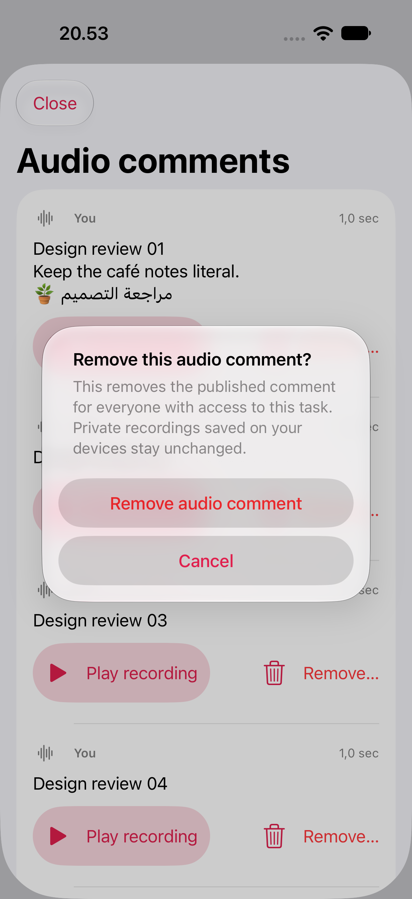
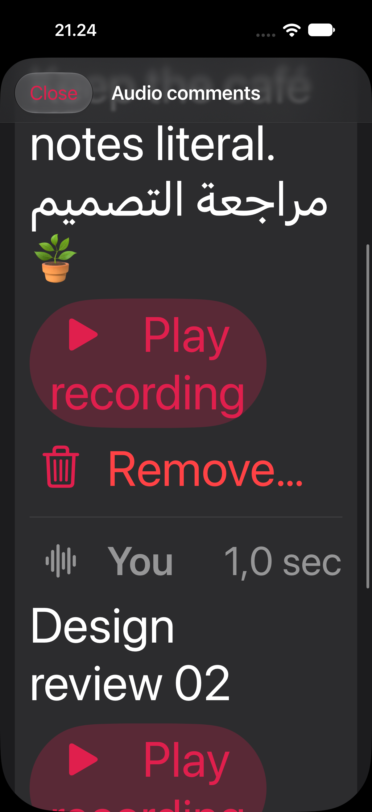
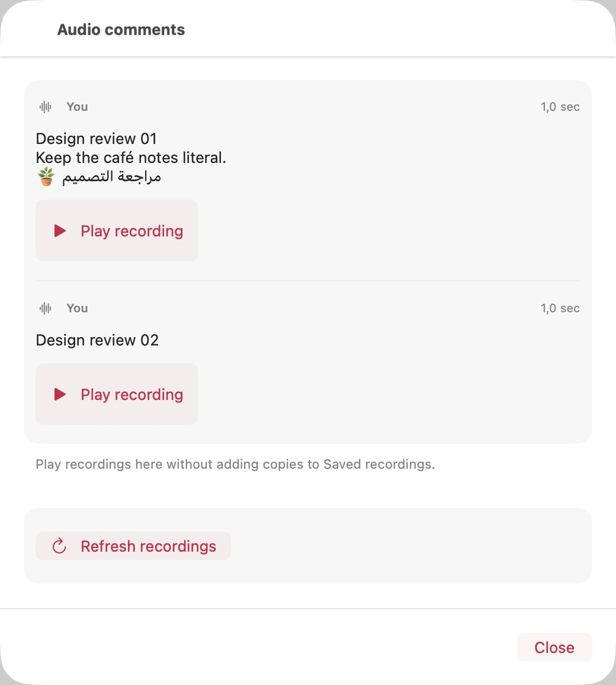

# Native audio conversation checkpoint — 28 October 2026

The actual conversation view/controller now has explicit Cancel/Remove confirmation,
44-point playback/removal targets, named Play/Stop controls, stacked actions at
accessibility sizes, literal multiline captions and an unambiguous denied-access
state. Normal audio exposure/publishing switches remain off.

## Accepted scope

- [x] iPhone 18 Pro and iPad Pro 13-inch (M5), iOS 27 Simulator: five UI journeys
  each, zero failures/skips. Reader Play/Stop/Close preserves records and hides
  Remove. Owner Cancel retains the row; confirmed Remove retires exactly one.
  Load more reaches row 21 and stops. Workspace departure refuses late playback.
- [x] Native mobile dark Accessibility XXXL: Play/Remove remain reachable and at
  least 44 points high. Literal combining-mark, Arabic and emoji captions survive.
- [x] Genuine Simulator VoiceOver service output identifies the literal caption
  and “Play recording” button on both devices; its previous state is restored.
  This is system output, not inference from accessibility labels.
- [x] Native Mac CUA interactions: reader Play/Stop/Close; owner Cancel/Remove;
  final page; denied-page clearing/preservation; departure refuses playback.
  All 16 recorded AX/state assertions pass. This is component UI acceptance,
  using synthetic transport and a silent player, not live Store/provider custody.
- [x] Final Mac accessibility-size sheet: injecting the size directly into the
  sheet produces stacked actions and readable captions, visually verified in
  mac-large-layout-final.png. Fixture size is restored; counts remain unchanged.

[Phone matrix](phone-matrix.json) · [iPad matrix](ipad-matrix.json) ·
[Phone spoken output](phone-voiceover.json) · [iPad spoken output](ipad-voiceover.json) ·
[Mac checks](mac-native-checks.json) · [Final builds](final-builds.json) ·
[Final source bindings](source-bindings.json).

## Build phases and limits

The five-test matrices used the version in [initial-mobile-build.json](initial-mobile-build.json).
After those passed, the denied-access branch stopped also displaying “No audio
comments,” and the footer was shortened. A final focused mobile check covers that
changed branch plus the largest-text controls; its results are recorded separately.
The first iPad attempt exposed an overly strict four-point test scroll margin,
not clipped app content; focused-first-attempt.json records the correction.
Both final focused checks pass (one test per device, zero failures/skips and no
reported runtime warnings): [phone](phone-focused-final.json),
[iPad](ipad-focused-final.json). The final app/test hashes include the loaded debug-code dylib as well as the
executable stub. Mac CUA functional evidence predates only the final fixture-only
size-injection change; the production view is identical.

Mac XCTest failed three times before observing the initial fixture window. Those
are failed startup attempts, not passing Mac tests. Native CUA then reached and
exercised the component. Raw failed runner dumps include unrelated global menu
content and are intentionally excluded; the sanitized status is in mac-native-checks.json.
No clean Mac XCTest runtime certificate is claimed.

The fixture is DEBUG-only, requires the reserved team-editor test bundle and
explicit launch flags, and uses in-memory rows with a fully decoded synthetic AAC
clip and silent playback. It accesses no microphone, speaker, real account, token
or hosted media. The normal Store admission/player remain in the production path.
iOS Simulator ad-hoc signing and isolated Mac Apple Development signing do not
accept release signing, private-Keychain access, physical devices or distribution.

## Reproduce

Run each repo independently; no sibling source/build dependency is required:

```sh
python3 Scripts/prepare_team_editor_native_test.py --output /tmp/taskfold-conversation-isolated
```

Build the prepared project for the desired platform, then select these tests:

```text
testAudioConversationReadOnlyNativePlaybackAndClose
testAudioConversationNativePaginationAndRemovalConfirmation
testAudioConversationLargestTextControlsAndDeniedPage
testAudioConversationDepartureRejectsLatePlayback
testAudioConversationVoiceOverNamesAndLiteralCaption   # iOS 27 only
```

Use `TaskfoldUITests/TaskfoldUITests` on iOS and
`TaskfoldUITests/TaskfoldMacUITests` on Mac. Launch the reserved Mac host with
`--uitesting --team-editor-testing --audio-conversation-testing
--audio-conversation-short -ApplePersistenceIgnoreState YES`; its synthetic
presets reset only memory and expose counts for verification. The Large text
fixture checkbox changes the presented component environment, not macOS settings.

## Still open

- Full Store/gateway activation and shared-account native UI lifecycle; this seam
  accepts the conversation component separately from the earlier database/native
  API proof in [shared reads](../audio-shared-read/README.md).
- Native publisher/pending-copy controls, uncertain-upload terminal recovery,
  legacy unbound journal/compact-history policy, separately authorized team audio
  writes/custody and unified text/audio timeline.
- Real hosted provider/custody/removal acceptance and user-deferred microphone,
  dictation and audible playback checks. The full audio/Px objective stays open.

## Visual samples







Follow-up: the [mixed text/audio timeline](../conversation-timeline/README.md) reuses these audio controls in shared conversations. Its evidence is separate from this earlier audio-only checkpoint.
