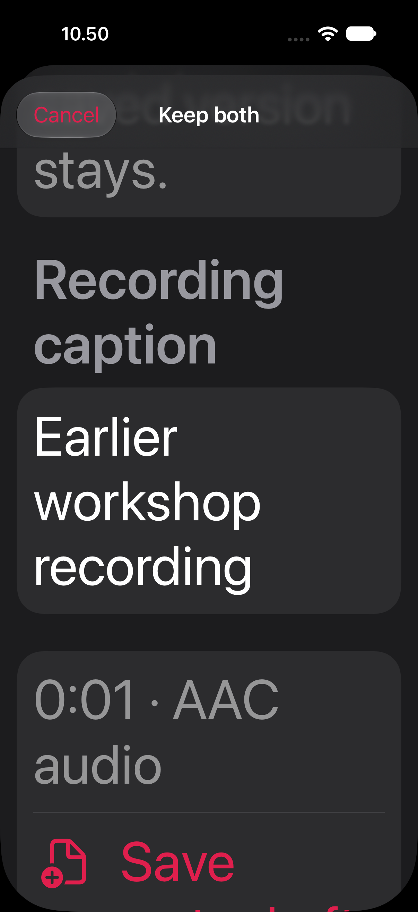
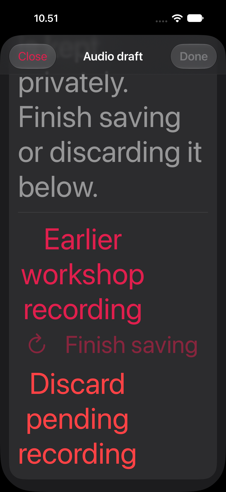
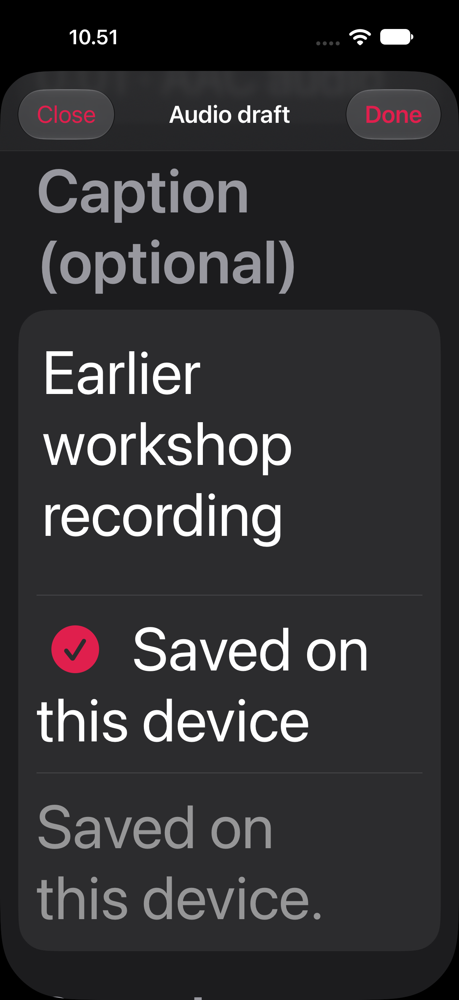
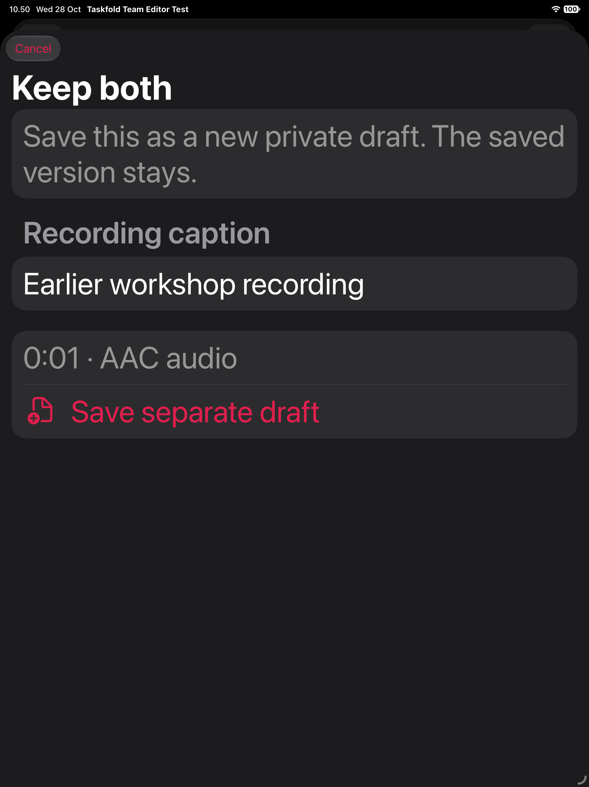
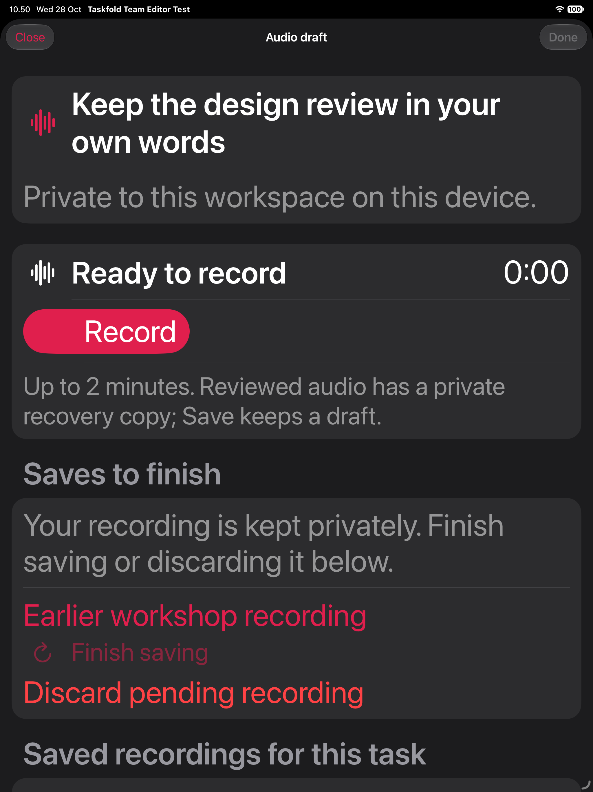
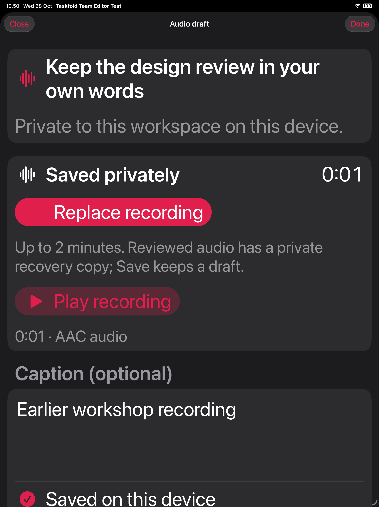

# Keep both interrupted recordings — 28 October 2026

## Behavior

The private recording screen now offers **Keep both…** beside Recover recording.
A separate review shows the full caption and duration, with Cancel and explicit
Save separate draft. Cancel writes nothing. Saving creates a new private draft
with independent IDs/provenance and retains the newer saved version unchanged.
Normal Recover still restores an unsaved review as a review, requiring its own
explicit Save. Both row buttons use independent borderless styles and minimum
44-point height; neither action activates the other.

The new Save journals one exact interrupted-stage reference: generated stage UUID,
local draft/review kind and SHA-256 of the complete original payload. Its first
admission validates account, target, exact audio/caption, different draft/revision
IDs and independent provenance. It cannot claim an existing draft, retarget a
recording, attach another review's cleanup or reinterpret a publication.

The journal is durable before the new draft is written. Only after the copy is
durable can the exact source stage be removed, followed by synchronized cleanup
and journal removal. Changed stage bytes are kept. Retries and cold Finish retain
the original IDs. Concurrent editors join the first durable authorization. An
unpromoted Save/discard journal blocks a competing copy without being promoted or
automatically finished. Such stages still need their separate recovery workflow.

A fresh quota/busy refusal releases the attempted copy only after checking that
its exact source remains durable. It returns to the usable recording list rather
than trapping Quit behind a new, unwritten copy. Unknown storage state retains
the frozen authorization. Discarding a prepared copy keeps the original stage.
No microphone, playback, remote upload or ordinary task entry point is added.

## Local journal compatibility

Existing ordinary local Saves keep their exact v2 field shape. Only the new staged
copy uses strict `taskfold-audio-save-v3` with its bounded stage reference. Current
clients read v1/v2 and v3; older readers refuse the unfamiliar journal rather than
reinterpret its cleanup permission. This is private local recovery, not a backend,
portable template, cross-device or release migration. Ordinary audio stays gated.

## Verification

Each independently owned repository passes **115 focused Core cases**, including
12 new cases for both source kinds, exact old-byte preservation, quota/retry,
changed/missing files, malformed/widened v3 references, pre-rename Save/discard
claims, cancellation and three copy commit checkpoints. Ordinary v2 decoding and
field shape remain covered. Existing unrelated test-source compiler warnings are
retained in the Core logs; they are not claimed resolved.

Each repository passes **166 actual controller/codec/vault checks**, zero compiler
warnings. Eighteen new checks cover Keep both, protected stage discovery, exact
cold Finish after journal/draft interruptions, changed-source refusal, independent
review retention, workspace departure and usable quota refusal. Recorder/player
drivers are synthetic; the controller, storage and codec validation are real.

The new executable proof passes **seven separate processes per repo**: prepare →
Finish → verify, and prepare → lost acknowledgement after draft commit → Finish →
verify. It checks the same operation/copy IDs, one saved copy, unchanged original
bytes, removed exact source and no remaining journal. Injected lost acknowledgement
plus process exit is not a physical power-loss test. Its owned temporary tree is
removed. `processes.json` binds the source and linked Core archive.

Both isolated app builds and strict/deep signatures pass. build.json binds the
changed native inputs to each app's independently owned source and binary hash.
This is Debug build/sign evidence; Mac native interaction and release distribution
remain separate. Native result summaries/logs and images are retained below.

Commands: `swift test --scratch-path <scratch> --filter
'AudioCommentTests|AudioCommentVaultTests'`, refresh the exact Core static archive,
then `Scripts/test_audio_comment_capture.py` and
`Scripts/test_audio_interrupted_copy_processes.py --scratch <scratch> --output <json>`.
All inputs are synthetic. No credentials or real task data are read or changed.

## Native scope and retained regression

The new case seeds one newer saved recording and an earlier complete staged file.
Real controls review the full caption, Cancel without mutation, explicitly choose
Save separate draft, lose acknowledgement after journaling, terminate/relaunch,
then explicitly Finish the original journal. File readback proves two independent
IDs, identical expected audio, unchanged original bytes and exact-stage cleanup;
a second cold return verifies both persisted recordings. The ordinary primary /
unsaved-review recovery case runs alongside it as a regression. Both use dark
Accessibility XXXL, and all target controls must fit the actual sheet viewport.

The first two-case suite failed on each device: Keep both passed, but ordinary
Recover also opened the sibling Keep both sheet because both buttons inherited
Form row behavior. The failure screenshot shows that unexpected sheet with the
ordinary-recovery caption. Independent borderless button styles fix the action
routing. The viewport assertion was kept. Preceding rejected suites are retained;
the earlier passing new case is not substituted for final-source acceptance.

Final-source native acceptance passes **two cases each on iPhone and iPad
Simulator**: four actual passes, no skipped/failed cases or reported runtime
warnings. All 12 final images were inspected. Normal Recover now acts independently
and preserves the unsaved-review step; Keep both retains exactly two saved versions
through its journal interruption and both cold returns. No genuine media driver,
permission, VoiceOver, private server or Mac UI acceptance is implied.

| Keep both review | Cold Finish | Both versions retained |
|---|---|---|
|  |  |  |
|  |  |  |

The ordinary recovery regression is retained in phone-4/5/6.png and
ipad-4/5/6.png, alongside the strict per-device summaries and compressed logs.

## Remaining work

Ordinary audio entry points remain gated. Full damaged-file repair/export/cleanup,
reviewed recovery of Save/publication stage journals, wider account/window/removal/
backup lifecycle, busy real-recording Quit, ordinary task integration and private
server media custody remain open. Genuine microphone/speaker/TCC/spoken and release
checks remain deferred. These results do not complete audio comments or the Px goal.
