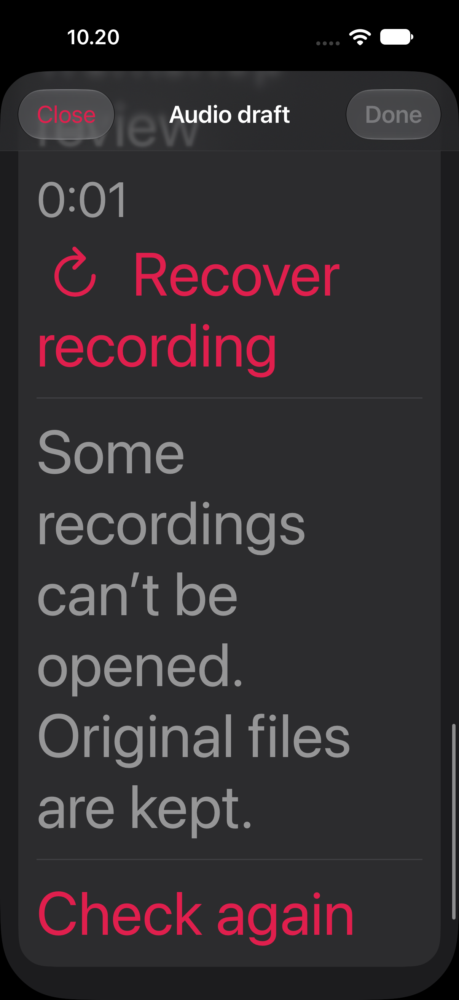
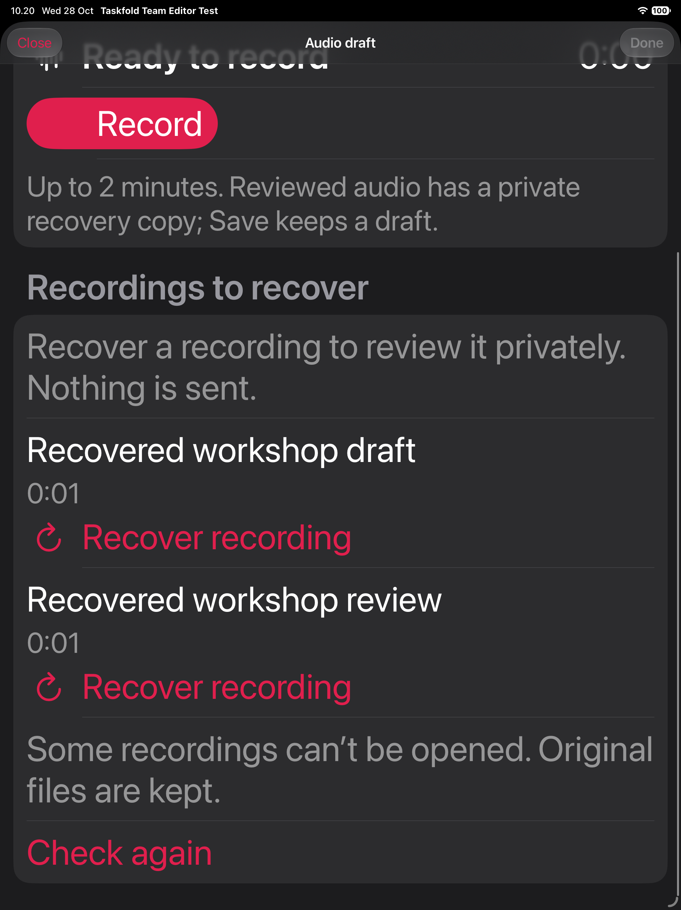
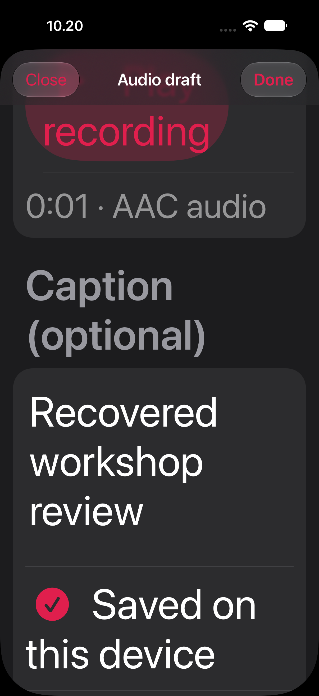
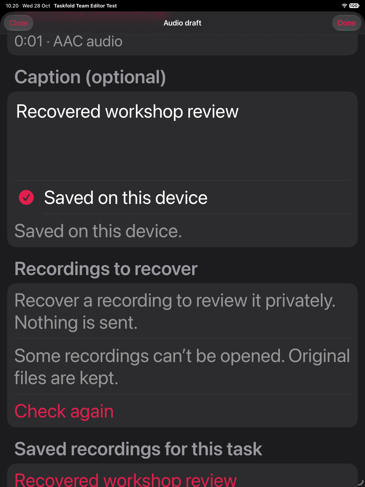
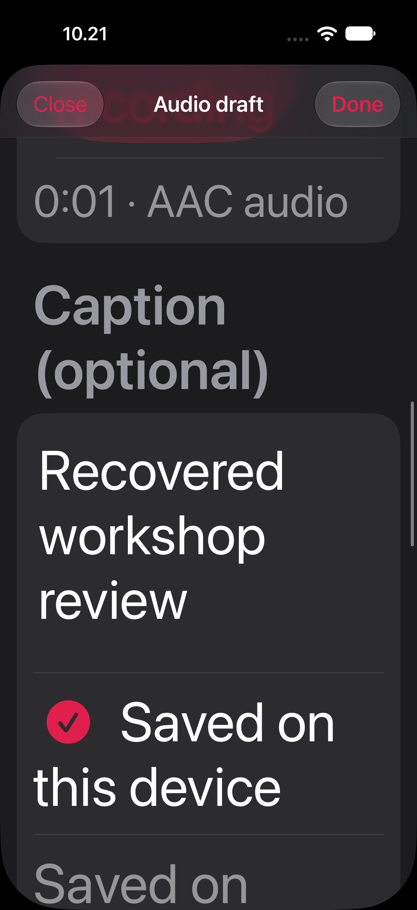
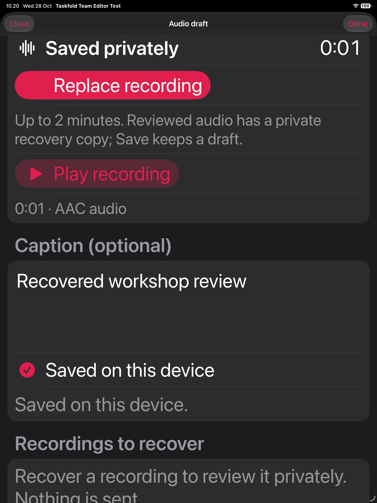

# Complete interrupted recording files — 28 October 2026

## Behavior

The private audio draft screen discovers complete pre-rename files for the current
account/task/incarnation and offers **Recover recording**. Each explicit recovery
validates its actual bounded audio before the vault rechecks exact staged bytes
and commits the rename under its process lock. Discovery never promotes a file.
A recovered primary is listed among saved recordings; a recovered unsaved review
stays in Interrupted reviews until the user opens it and explicitly saves.

Unreadable payloads remain byte-for-byte on disk with a concise warning; readable
stages remain available. Filesystem/link/size/ownership/locking errors still refuse
the scan. Storage is still bounded; this is not arbitrary damaged-file repair or
an automatic deletion policy. A changed/conflicting stage is refused and kept.
Save-journal and publication stages retain their original kinds and are flagged
for separate recovery; the local draft UI cannot reinterpret or finish them.

Primary recovery now refuses an outstanding Save for the same draft. Replacement
also preserves the current recovery provenance, matching ordinary draft Save.
Both regressions fail against the baseline recorded in baseline.json and pass in
the final Core source. The first reproduction attempt omitted a required Save
fence and was a setup error, excluded from accepted before evidence; the retained
regression-before.log.gz is the corrected, two-case reproduction.

## Verification

- Each independent repo: **103 focused Core cases**, including seven new cases
  covering mixed complete/incomplete stages, owner isolation, symbolic/hard-link
  refusal, preserved journal kinds, bounded inventories and the two guard fixes.
- Each repo: **148 actual controller/codec/vault checks**, zero compiler warnings,
  with synthetic recorder/player drivers. Twelve new checks cover explicit
  discovery/recovery, kind separation, unchanged corrupt/foreign/journal bytes,
  changed-stage refusal and clearing private rows on departure.
- Each repo: the existing **16-process** storage proof passes; separate racing
  editors establish their snapshots before release and converge on one saved
  recording. These are storage/claim regressions, not microphone acceptance.
- Both isolated app builds and strict deep code-signature verification pass.
  build.json binds changed native inputs to the repository and records binary
  hashes. The iOS signing receipt preserves the owned host/App Group identities.

Core command: `swift test --scratch-path <owned-scratch> --filter
'AudioCommentTests|AudioCommentVaultTests'`. The executable proofs use that exact
compiled Core object with its static archive refreshed, followed by
`Scripts/test_audio_comment_capture.py`,
`Scripts/test_audio_comment_vault_processes.py` and
`Scripts/test_audio_claim_processes.py`. Results, source hashes and compressed
logs are retained here.

## Native scope

The DEBUG-only fixture seeds two complete synthetic pre-rename files (primary and
unsaved review) plus an incomplete payload. It does not claim to interrupt a live
microphone write. The native test uses real UI controls to recover each, checks
private files and their kinds, opens/reviews/saves only the recovered review,
then cold-relaunches without reseeding. It checks both saved captions, exact
preservation of the original primary and unchanged incomplete bytes. It runs in
dark Accessibility XXXL and requires the complete target control/text inside the
actual sheet viewport, below navigation and above fixture overlays.

The first phone run caught a 589-point warning that did not fit that viewport.
The warning and recovery explanation were shortened; the viewport assertion was
kept unchanged. The rejected result and failure screenshot are retained. The
preceding iPad run passed, but it is not substituted for final-source acceptance.

Final-source acceptance passes one selected native case each on **iPhone and iPad
Simulator**, zero skipped/failed cases and no reported runtime warnings. All six
retained final images were inspected. The shorter warning fits the tested viewport
without reducing the selected text size or relaxing the assertion.

| iPhone | iPad |
|---|---|
|  |  |
|  |  |
|  |  |

## Open gates

Ordinary audio entry points stay gated. Conflicting-stage choices, repair/cleanup
of unreadable files, authorized Save/publication-stage recovery, wider
account/window/removal/backup lifecycle, automatic Quit during real recording,
ordinary app integration and private server custody remain open. Current Mac
runtime, genuine recording/playback/permissions/spoken acceptance and release
installation are not established by these builds. The user's genuine-media and
release/provider deferrals remain in force. Audio comments and the Px goal are
not complete.
