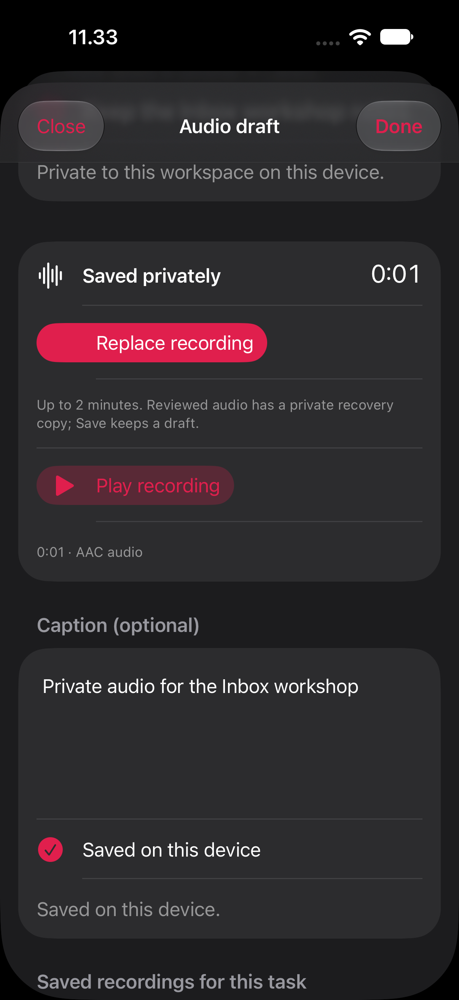
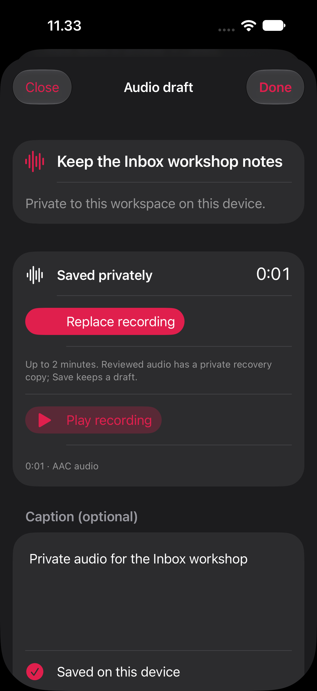
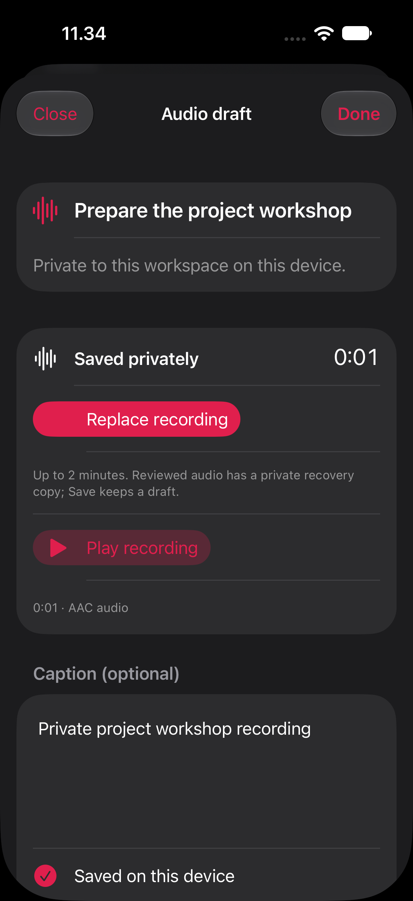
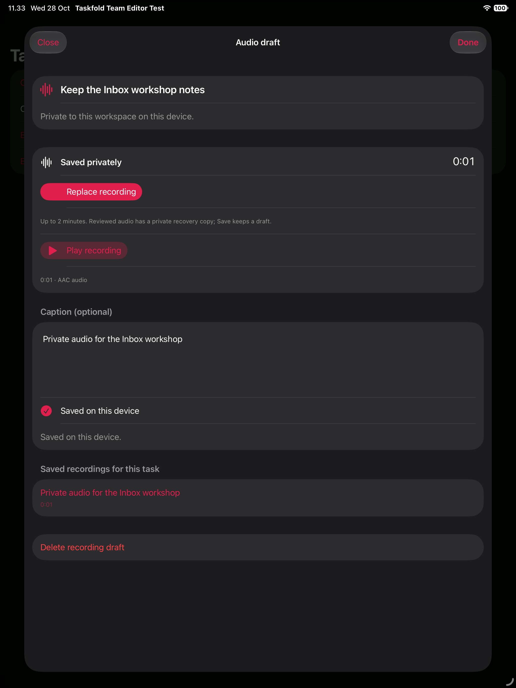
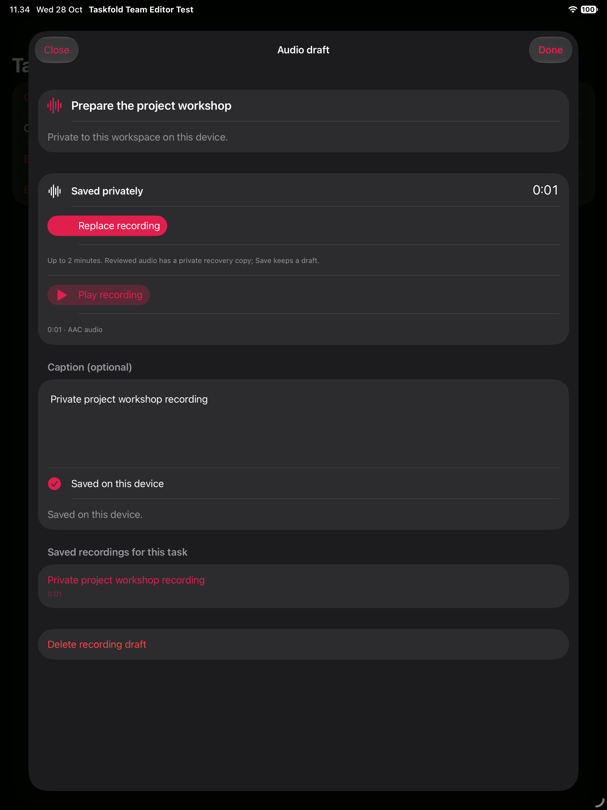

# Task-bound private audio drafts — 28 October 2026

## Implementation

Saved personal root task editors now have a connected **Open private recordings**
entry candidate, including Inbox tasks with no project. iOS keeps its Save/Cancel
editor; Mac keeps its inspector/autosave flow. Unsaved/embedded/shared-task entry
points are not admitted by this personal-root adapter. The code remains behind
`TaskfoldAudioDraftsEnabled`, absent from both normal app configurations. Only the
exact isolated debug host and explicit audio-task-editor test flag bypass it.

Admission requires a readable, writable current Store workspace, exact raw owner,
recognized task kind, valid task/generation IDs and an accessible owned personal
project when present. Missing/ambiguous/foreign/team/archived project metadata and
unknown task kinds refuse. Inherited archive status is respected. Legacy tasks
without a stable generation require a separate migration/admission path; the app
does not invent a generation or mutate task data merely to attach audio.

The opened request stays bound to workspace incarnation, account, server origin,
root task generation and project. It uses the editor's actual record key, retaining
valid UUID spelling. Scope is checked before resolving storage, after asynchronous
opening and throughout recording/review. A server change also invalidates the
capture and clears playback/private preview. Store permission loss, sign-out,
source removal and generation/project changes cannot redirect a stale request.
Broader authenticated/cloud/multi-window runtime remains separate acceptance.

Storage is beneath a dedicated app-identity hash, then a local/server hash and
raw-account hash. Another build identity or server cannot share the same private
vault accidentally. Directory preparation runs away from the UI actor, checks
ownership/link safety, sets 0700 permissions and excludes the media namespace from
automatic backup. Existing vault codec, process locking and Save/recovery workflow
are reused. Task/editor Snapshot JSON, App Groups and portable task exports do not
receive audio bytes or captions. The entry explains device-only storage and the
export exclusion; incomplete media backup/removal custody still blocks exposure.

The app wrapper creates the actual device recorder/player only for a live request;
opening it requests no microphone permission. Isolated tests substitute only the
silent media drivers. They exercise the real Store, root task editor, admission,
namespace preparation, codec, vault and recording screen. No real microphone,
speaker, credential, hosted write or user task is used. Fixture reset is limited
to the known synthetic account within its own app namespace.

## Verification

Each repo passes **123 selected Core cases**: the preceding 115 audio cases plus
eight new admission/storage cases. They cover Inbox and project roots, heading
reference context, malformed/foreign/legacy targets, inherited archive/duplicate
metadata refusal, project/generation change, app/server namespace separation,
actual actor open/reopen, permissions, backup exclusion and symlink refusal.
Existing unrelated test-source compiler warnings remain in the compressed logs.

Each repo passes **170 actual controller/codec/vault checks**, zero compiler
warnings: the preceding 166 plus exact-origin binding and clearing private preview
on another server while retaining the original disk data. The controller executable
excludes the app Store extension; native acceptance separately exercises that
bridge. Neither count establishes genuine hardware/permission or hosted Auth.

Both isolated app builds and strict deep signatures pass. build.json verifies
normal exposure is absent in the built Info.plist and binds changed inputs/binary
hashes. Mac has independent inspector integration and compile/sign acceptance;
current Mac native interaction remains open. No cross-repo source/build dependency
was introduced. The fixture's local flow is not cloud/personal-service acceptance.

## Native scenario

The real iOS task editor opens private recording for a stored Inbox task. The user
flow records synthetic AAC, edits its private caption, explicitly saves, terminates,
relaunches and reopens the same Inbox recording. A different project's task starts
with no Inbox recording visible, gets its own recording, and survives another
cold return. Independent file readback verifies exact saved bytes and two private
files, while canonical task-table bytes stay unchanged throughout. Captions never
appear in task JSON. The earlier accepted runs precede the app-specific namespace or narrower reset;
the final suite uses the current app/namespace and scoped-reset code.

A separate native reset case writes opaque bytes under a synthetic other-owner
directory and verifies that resetting the test account preserves those bytes. Its
owned sentinel directory is removed afterward. This is fixture cleanup isolation,
not a real authenticated account-switch acceptance claim.

Earlier native summaries/logs are retained as preceding scope. The initial build
attempt corrected fixture-only Mutation argument ordering and an optional project
argument; it is not accepted runtime evidence. Final native results/captures are
recorded below. No VoiceOver or real device/audio acceptance is implied.

Final-source native acceptance passes **two cases each on iPhone and iPad
Simulator**, four actual passes with no skips/failures or reported runtime warnings.
All six final screenshots were inspected. These are local Store/native flows with
silent synthetic recording. Personal cloud, Mac UI, largest-text/spoken, actual
hardware capture/playback and user-deferred permission checks remain separate.

| Inbox saved | Inbox cold return | Project cold return |
|---|---|---|
|  |  |  |
|  |  |  |

## Open work

Normal exposure stays off. Personal cloud/role/multi-window runtime, shared and
child targets, legacy generation admission, account-removal and move custody,
portable media backup/export/restore, reviewed recovery of staged action journals,
private server publication/access and genuine recording/playback/TCC/spoken checks
remain open. The user's media, provider, rollout and distribution deferrals are
unchanged. This connects the app candidate; it does not complete audio comments
or the whole Px objective.
