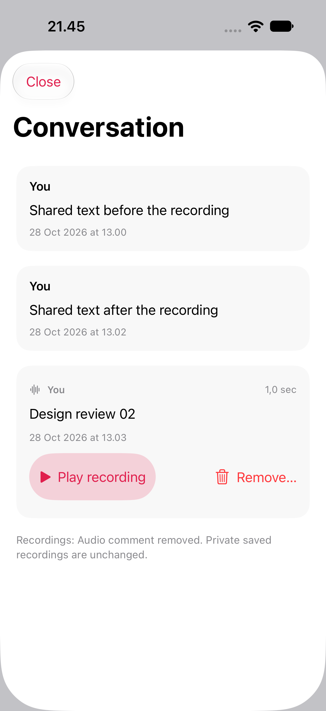
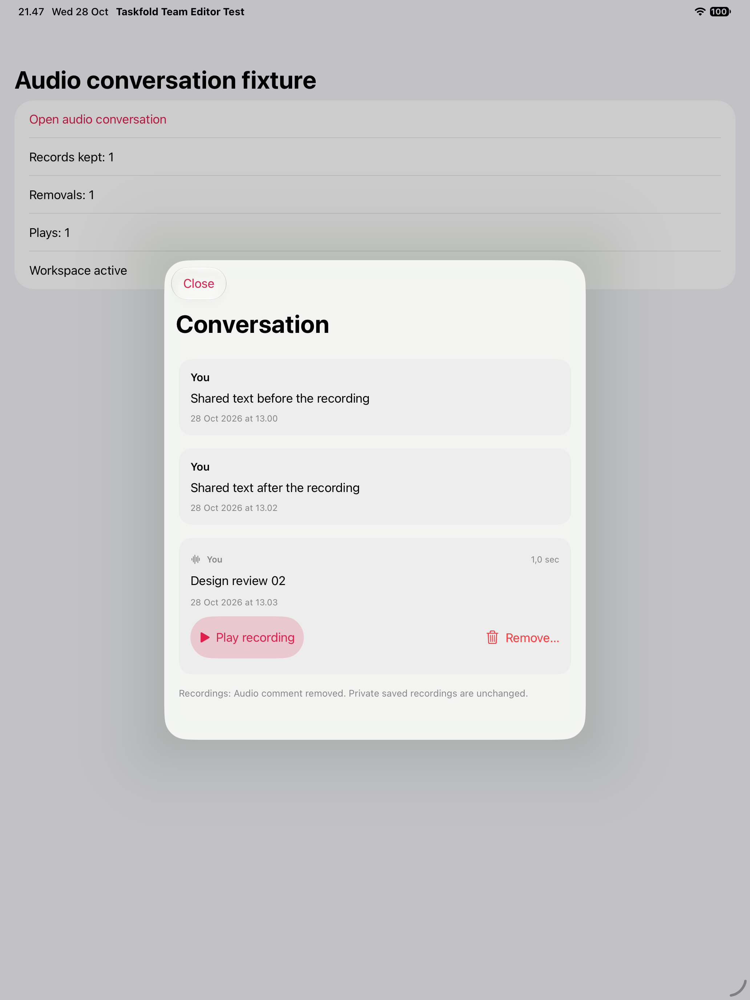

# Mixed conversation timeline — 28 October 2026

Shared conversations now interleave authenticated text comments and authorized
published audio in one timeline. Text uses original creation time, so editing a
comment does not move it; audio uses publication time. Independent text/audio
paging controls remain explicit, and partial conversations are labeled. Legacy
imported comment text remains in task details rather than being treated as an
authenticated author record. Ordinary audio feature switches remain off.

The existing text Edit/Remove/composer and selected-mention task routes are
retained. Audio reuses the same accessible row as the dedicated reader, with
publication date, Play/Stop and explicit Cancel/Remove confirmation. Removing
published audio leaves independently admitted text and private recordings alone.

## Integrity and lifecycle

- Medium-qualified IDs allow a text and audio UUID to coexist without replacing
  either row. Original bodies/captions remain literal, including Unicode.
- UTC-equivalent offsets and fractions sort consistently. Original fractional
  digits preserve PostgreSQL microseconds that Foundation formatters can truncate.
  Timestamp formatters are reused within each merge rather than created per row.
- The merge excludes another task, generation, project or audio reader account.
  It is presentation filtering, not a replacement for live Store/backend authority.
- Audio admission also matches the parent workspace/task/project before constructing
  a reader. Session/scene/workspace changes close the controller and clear its
  ephemeral records; late download callbacks cannot start playback.
- Metadata is fetched on entry/Refresh, with a separate audio cursor. Audio media
  downloads only after explicit Play. No audio is persisted in the text snapshot,
  exports, mentions or outbox, and no new publishing permission is introduced.

## Verification

The final Core run passes 37 selected tests in each independent repo: the existing
29 shared-comment cases plus eight new timeline cases. They cover interleaved
ordering, edit position, exact microseconds, offset/fraction equality, cross-medium
ID collisions, task/account/project/generation filtering, deleted text, literal
content and merging newly loaded pages without changing existing identities.

Both final mobile runs pass five UI cases each, with zero failures/skips and no
reported runtime warnings: audio-only reader regression, mention-to-task editor,
mixed playback/Cancel/Remove with text preservation, audio access loss refusing
playback while retaining text, and genuine Simulator VoiceOver across both media.
The previous VoiceOver state is restored. The final captures were visually
inspected on phone and tablet. These native runs belong to the iOS repo; Mac
runtime remains unverified here because the Mac was locked (no new app launched).

[Phone results](phone.json) · [iPad results](ipad.json) ·
[Phone speech](phone-voiceover.json) · [iPad speech](ipad-voiceover.json) ·
[Builds](builds.json) · [Source bindings](source-bindings.json) ·
[First-attempt corrections](first-attempt.json) · [Mac runtime status](mac-runtime.json).

The first runs exposed missing/ambiguous test probes and a Browse viewport lookup;
the rerun changes only DEBUG fixture/test code. Earlier counts/failures and source/
binary bindings are retained separately; the incomplete first iPad diagnostic
bundle is not counted as final acceptance. The final app code matches the code
used for the initial functional runs; the final mobile test binary and DEBUG
play-count probe are separately bound in builds.json/source-bindings.json.

Native build/results, source bindings and screenshots are recorded alongside this
file. Native fixtures use the real view/controller and decoders with in-memory
transport and silent playback. They do not accept real media/provider custody or
full signed-in Store/gateway activation. No user data or credentials are used.

## Reproduction

Run each repo independently:

```sh
swift test --scratch-path /tmp/taskfold-timeline-core --jobs 2 \
  --filter 'SharedCommentsTests|ConversationTimelineTests'
python3 Scripts/prepare_team_editor_native_test.py --output /tmp/taskfold-timeline-host
```

Build the prepared host, then select the timeline tests in AudioCommentUITests.
Its reserved DEBUG fixture requires `--uitesting --team-editor-testing
--audio-conversation-testing --audio-timeline-testing --audio-conversation-short`.
Without that exact isolated bundle gate these fixture arguments do not activate.
The ordinary text-only conversation fixture separately exercises existing task
navigation. Each app owns its source; neither imports files from the sibling repo.

## Remaining

Full signed-in Store/gateway lifecycle, wider shared-account/Mac/spoken/large-text
acceptance, team publishing/removal/custody, unknown-upload/legacy-history recovery
and real provider acceptance remain open. Genuine microphone/dictation/audible
playback remains user-deferred. Native component proof does not complete the
whole audio/Px feature or release gates.

## Captures




